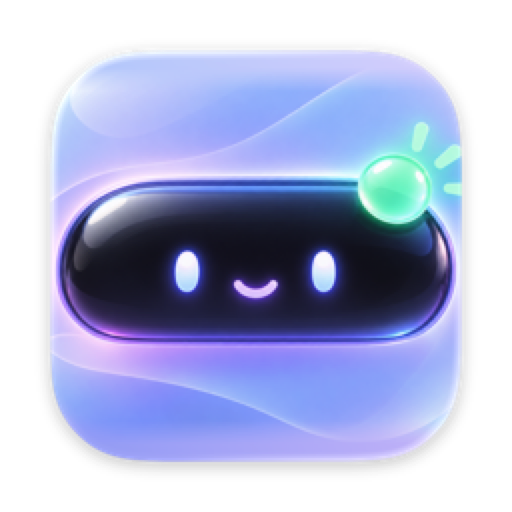
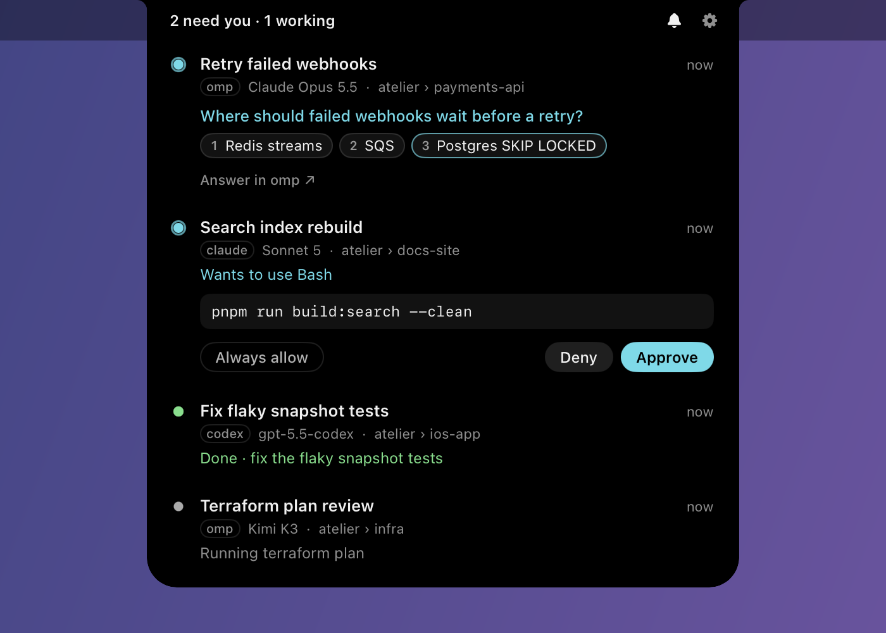

<p align="center">
  
</p>

<h1 align="center">Nubbin</h1>

<p align="center">Your coding agents, in the notch.</p>

<p align="center">
  
</p>

Nubbin is a macOS menu bar app. It chimes when an agent needs you, finishes, or fails, and shows what it wants in the notch. Click a row to jump to its terminal pane.

<p align="center">
  
</p>

## Agents

Every agent shows when it is working and when it is done.

| Agent | Connects through | Also shows | Answer in the notch |
|---|---|---|---|
| [omp](https://omp.sh) | extension | current step, questions and options, approvals, failures | no |
| [Claude Code](https://docs.anthropic.com/en/docs/claude-code) | hooks | questions and options, approvals, failures | approvals |
| [Codex](https://github.com/openai/codex) | hooks | the command it wants to run | no |
| [pi](https://github.com/earendil-works/pi) | extension | failures | no |

Where the notch can't answer, click the row to jump to the pane and answer there.

In [zellij](https://zellij.dev), each row names its session and tab, and a click switches to that tab and pane. Any tab that rings the terminal bell gets a row too.

## Install

Download `Nubbin-<version>.dmg` from [Releases](https://github.com/JacobCoffee/nubbin/releases) and drag Nubbin to Applications. It runs on Apple silicon with macOS 14 or later. Releases are immutable, and each one ships a CycloneDX SBOM, SHA-256 checksums, and GitHub build-provenance and SBOM attestations. Check that a download was built by this repo's release workflow:

```sh
gh attestation verify Nubbin-v0.2.0.dmg --repo JacobCoffee/nubbin
```

Unless a release says it's notarized, it's ad-hoc signed and macOS blocks the first launch: allow it in System Settings › Privacy & Security › **Open Anyway**.

To build from source you need Xcode 26 or later:

```sh
make install
open ~/Applications/Nubbin.app
```

Then connect your agents, either from **Settings › Agents** or with:

```sh
make hooks
```

Nubbin backs up each settings file before it changes it, and leaves other hooks alone.

- **Codex** runs new hooks only after you approve them. Run `/hooks` in Codex.
- **omp**: run `/reload-plugins` in sessions that are already open.
- **pi**: restart open sessions.

Run `make` to list every target.

## Settings

Open Settings from the menu bar icon (⌘,) or the gear in the island. If you hide the menu bar icon (Settings › General), open Nubbin again from Spotlight or Finder to get Settings back. Each moment (needs you, finished, failed) has its own sound, volume, color, and ring. Trim any sound, or drop in your own. Press ⌘R to play a moment exactly as it will happen.

- **Reminders**: ring again after a delay, once, three times, or until it's handled.
- **Quiet**: silence chimes during Focus, calls (microphone or camera in use), mirrored displays, or quiet hours. The notch still rings. Turned-on Focus is read from `~/Library/DoNotDisturb`; scheduled Focus isn't visible to apps.
- **Away**: when the screen is locked or you've been idle, post to Notification Center, push to your phone through [ntfy](https://ntfy.sh), or both.
- **Agents**: per agent (and for zellij tab bells), chime, show only, or hide.
- **Island**: open on hover or only on click, dots for every session or only ones that need you, clear finished rows when you open them, and which display it lives on.
- **Shortcuts**: global hotkeys to open the island and to jump to the session that needs you.
- **Export/import**: move your settings to another Mac (sounds you added aren't included).

The menu bar icon shows how many sessions are waiting. Its menu lists every session (click to jump, hold ⌥ to dismiss), and can mute chimes for 15 minutes, an hour, three hours, or until tomorrow morning.

## How it works

Each agent runs `Nubbin hook`, or the bundled extension, on every event. It sends the event as JSON to a Unix socket at `~/Library/Application Support/Nubbin/events.sock`, which only you can read. Nothing leaves your Mac unless you set an ntfy topic for away notifications.

For a Claude Code approval, the hook waits for your answer. Claude keeps its own prompt open meanwhile, and the first answer wins.

Set `NUBBIN_DEBUG=1` to log events to stderr.

## Control API

The same socket (`~/Library/Application Support/Nubbin/events.sock`) also answers control
requests: list what Nubbin is showing, or jump to a row's pane, without clicking. Each request is
one JSON object per connection with `"await": true`, and the reply is written back on that
connection before it closes. `Nubbin ctl` sends these for you:

```sh
Nubbin ctl list           # {"ok":true,"rows":[...]}
Nubbin ctl focus <row id> # {"ok":true} or {"ok":false,"error":"unknown row"}
```

Raw requests, e.g. from another process:

```jsonc
// -> {"type":"list","await":true}
{
  "ok": true,
  "rows": [
    {
      "id": "agent:omp:abc123",       // "agent:<agent>:<session id>" or "bell:<session>:<tab id>"
      "source": "agent",              // "agent" | "bell"
      "agent": "omp",                 // "omp" | "claude" | "codex" | "pi" | null (bell rows)
      "title": "checkout-api",
      "model": "Claude Opus 5.5",     // null if the agent hasn't reported one
      "cwd": "/Users/you/checkout-api", // null if unknown
      "location": "atelier › loop",   // "session › tab" in zellij, null outside zellij
      "detail": "Set up the users table", // what it's doing/asking/done with, null if none
      "activity": "working",          // needsYou | error | done | working | idle
      "since": "2026-01-01T12:00:00Z", // when `activity` last changed, ISO 8601 UTC
      "zellij": { "session": "atelier", "tab_id": 3, "pane_id": 7 }, // null outside zellij
      "terminal_bundle_id": "com.mitchellh.ghostty" // null if unknown
    }
  ]
}
```

```jsonc
// -> {"type":"focus","id":"agent:omp:abc123","await":true}
{ "ok": true }
// unknown id:
{ "ok": false, "error": "unknown row" }
```

`focus` runs the exact code path a click on the row runs: it activates the row's terminal app,
then switches zellij to its tab and pane, and clears a finished row when **Clear on open** is set. Malformed requests or an unrecognized `"type"` reply
`{"ok":false,"error":"..."}` instead of hanging the connection. Agent hook events (the shape
above, under "How it works") never carry a top-level `"type"` key, so the two are never confused.

The socket is created with mode `0600`: only your user can connect, same as the hook path. Set
`NUBBIN_SOCKET` to point at a different socket path, or `NUBBIN_SUPPORT_DIR` to change where
Nubbin keeps the socket and everything else (sounds, etc.) — both the app and `Nubbin ctl`/`Nubbin
hook` honor these, which is how you'd run an isolated instance for testing.

## Uninstall

```sh
make unhooks
rm -rf ~/Applications/Nubbin.app "$HOME/Library/Application Support/Nubbin"
defaults delete dev.jacobcoffee.nubbin
```
